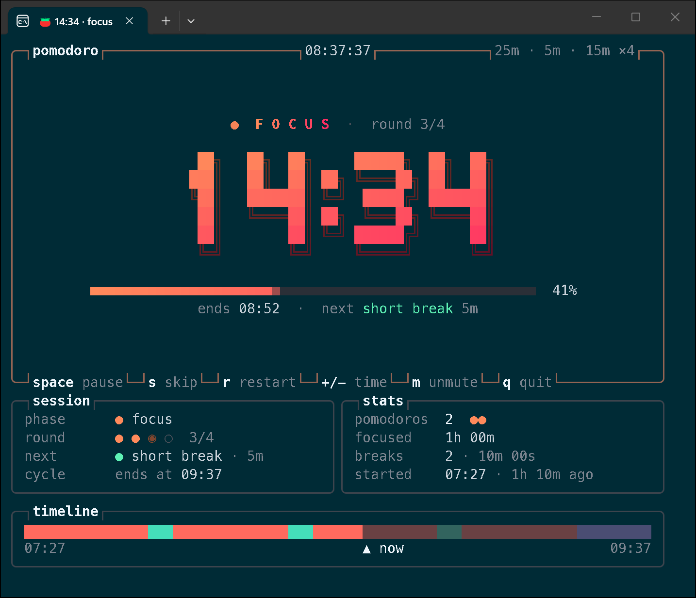

# pomodoro

A pomodoro timer for the terminal. Big clock, a progress bar, and that's about it.



I wanted a pomodoro timer that looks like btop but doesn't need a browser tab or another icon in the tray. It's one console app, plain ANSI escapes, no TUI library. Start it, leave it in a corner of the screen, and forget about it until it chimes.

> **Disclaimer:** this was 100% vibecoded with Claude Opus 5.5 on extra high reasoning.

---

## What it does

25 minutes of focus, 5 minutes of break, and every 4th break is 15. When a phase ends the border flashes, it chimes, and the next one starts on its own.

- **session** shows where you are in the cycle, what's next, and when the cycle ends.
- **stats** counts pomodoros, time focused and breaks since you started it.
- **timeline** is the whole session in one bar: what's done is in color, the rest of the cycle is dimmed, `▲` is now.
- The tab title shows the countdown (`🍅 14:34 · focus`), so you can keep an eye on it from another tab.
- Pausing dims the clock and makes it pulse, so you don't forget you paused it.
- Small window? The panels drop off until it's just the clock.

## Keys

| Key | |
|---|---|
| `space` | pause / resume |
| `s` | skip to the next phase |
| `r` | restart the current phase |
| `+` / `-` | add or take off a minute |
| `m` | mute |
| `q` / `Esc` | quit |

## Options

```
pomodoro                  # 25 / 5 / 15, 4 rounds
pomodoro 50 10 20 3       # focus, short break, long break, rounds
pomodoro -f 45 -r 3       # same thing with flags
pomodoro 0.2 0.1 0.15 2   # minutes can be fractional, handy to watch a whole cycle in a minute
```

`-m` starts it muted, `-c 256` / `-c 16` forces a color mode if the detection gets it wrong, `-h` for the rest.

## Run it

Needs the [.NET 10 SDK](https://dotnet.microsoft.com/download).

```
git clone https://github.com/lmartins18/pomodoro.git
cd pomodoro
dotnet run -c Release
```

Pass options after `--`, like `dotnet run -c Release -- 50 10 20 3`.

If you want a single exe that runs without .NET installed:

```
dotnet publish -c Release -r win-x64 --self-contained -p:PublishSingleFile=true
```

It ends up in `bin/Release/net10.0/win-x64/publish/` and it's about 70 MB, since the runtime is inside. Swap `win-x64` for `linux-x64`, `osx-arm64` and so on for other systems.

## Where it works

I built it on Windows 11 in Windows Terminal. It should work in Linux and macOS terminals too, but I haven't tried it there yet.

- **Colors:** 24-bit when the terminal supports it, 256 colors when it doesn't (like Terminal.app before macOS 26), and 16 as a last resort. The 16-color mode borrows your theme's colors, so it stays readable on themes like Solarized.
- **Sound:** a little chime on Windows, the terminal bell everywhere else.
- **Font:** needs one with box-drawing characters. Cascadia, Consolas, JetBrains Mono, Menlo, pretty much anything modern.
- **Theme:** made for dark themes. It works on light ones, it just doesn't look as good.
